# FutatsumeWatch

ZenzaWatch 後継ユーザースクリプト。動画リンクがある場所から、その場で動画を再生。

## インストール

Version 0.0.32

[FutatsumeWatch.user.js](https://github.com/roflsunriz/FutatsumeWatch/raw/main/dist/FutatsumeWatch.user.js)

## 使い方

1. Tampermonkey ([Chrome](https://chromewebstore.google.com/detail/tampermonkey/dhdgffkkebhmkfjojejmpbldmpobfkfo?hl=ja)) ([Firefox](https://addons.mozilla.org/ja/firefox/addon/tampermonkey/)) / Violentmonkey ([Chrome](https://chromewebstore.google.com/detail/violentmonkey/jinjaccalgkegednnccohejagnlnfdag)) ([Firefox](https://addons.mozilla.org/ja/firefox/addon/violentmonkey/)) / Greasemonkey ([Firefox](https://addons.mozilla.org/ja/firefox/addon/greasemonkey/)) をブラウザにインストールする
2. 上記リンクを開き、ユーザースクリプトマネージャの案内に従ってインストールする
3. ニコニコ動画・Nアニメ等の動画リンクや、ニコ百の埋め込みサムネイルに現れる起動ボタンをクリックし、再生
4. スクリプトマネージャでFutatsumeWatchを選択し、随時更新を手動チェック (自動チェックも可能)

### Tampermonkeyでインストールする

Chromeの例です。まず上記のTampermonkey配布ページを開き、「Chromeに追加」から拡張機能をインストールします。Firefoxでは上記のFirefox用リンクを使います。

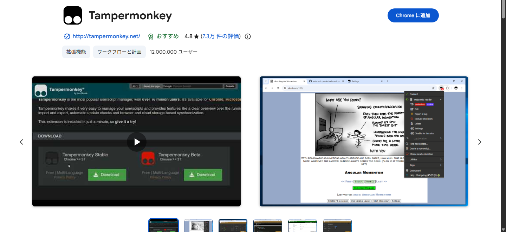

続いて上の「FutatsumeWatch.user.js」を開き、名前・作者・対象サイトを確認して「インストール」を押します。画像の版番号は撮影時のもので、配布リンクから現在の版をインストールできます。

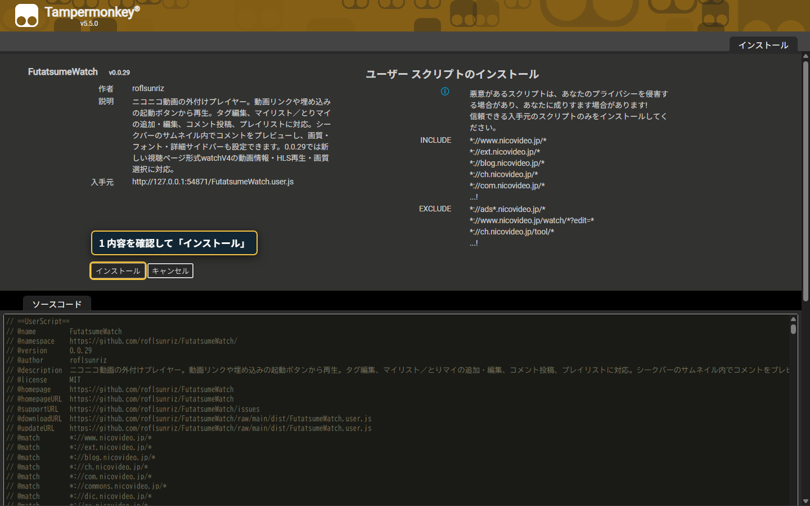

Chromeで「ユーザースクリプトを許可する」と案内された場合は、拡張機能の管理画面でTampermonkeyの詳細を開き、この許可を有効にしてください。導入前から開いていた動画ページは再読み込みします。

### FWボタンから再生する

動画リンクや埋め込みサムネイルに現れるFWボタンをクリックします。視聴ページでも、表示された起動ボタンから再生できます。

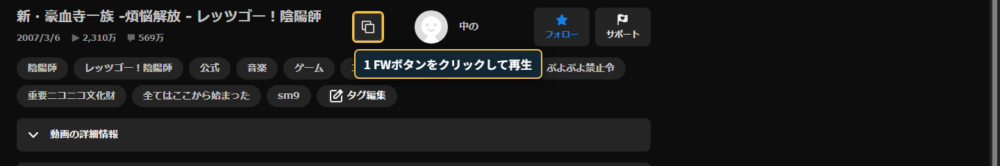

動画とコメントが同じ画面に表示されます。下の画像は実サイトの「レッツゴー！陰陽師」（sm9）を再生している場面です。

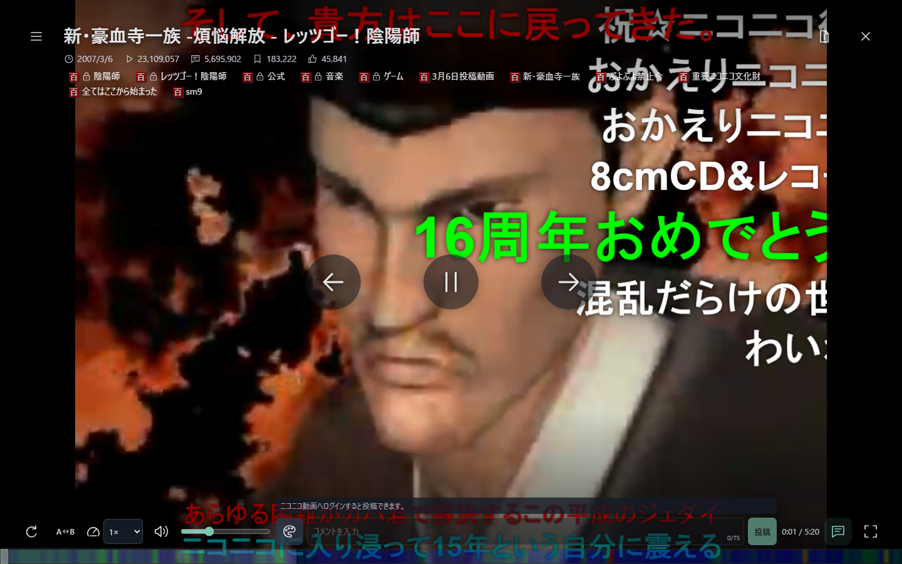

マウスを動かすと操作部が現れます。左上から設定、右上から動画情報などの右タブを開き、下のシークバーで再生位置を移動できます。

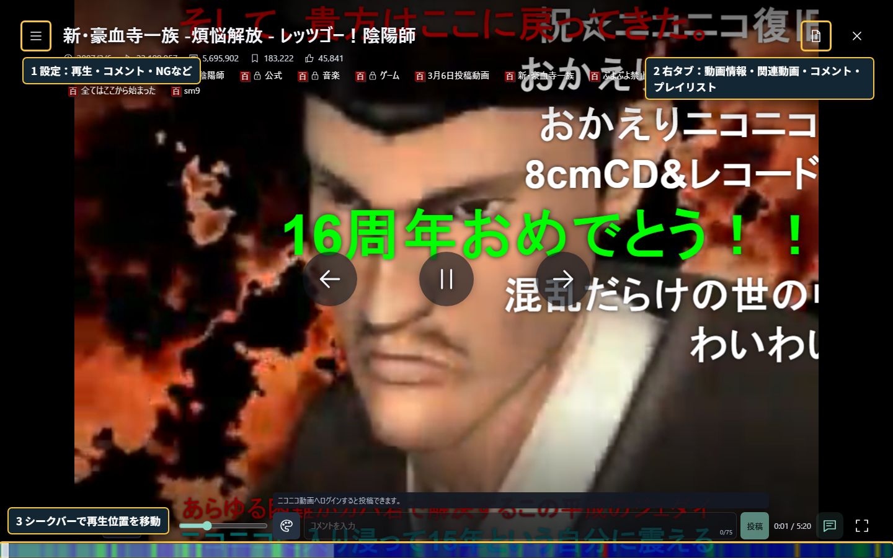

### 設定を変える

左上の設定ボタンを押し、左側のカテゴリを選びます。右側で各項目を変更でき、左側では画質も選べます。トグルは灰色がOFF、緑色がONです。×・Escape・背景クリックで閉じます。

プレイヤーの設定

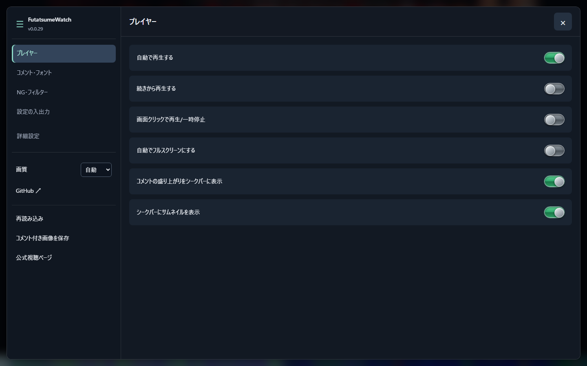

コメント・フォントの設定

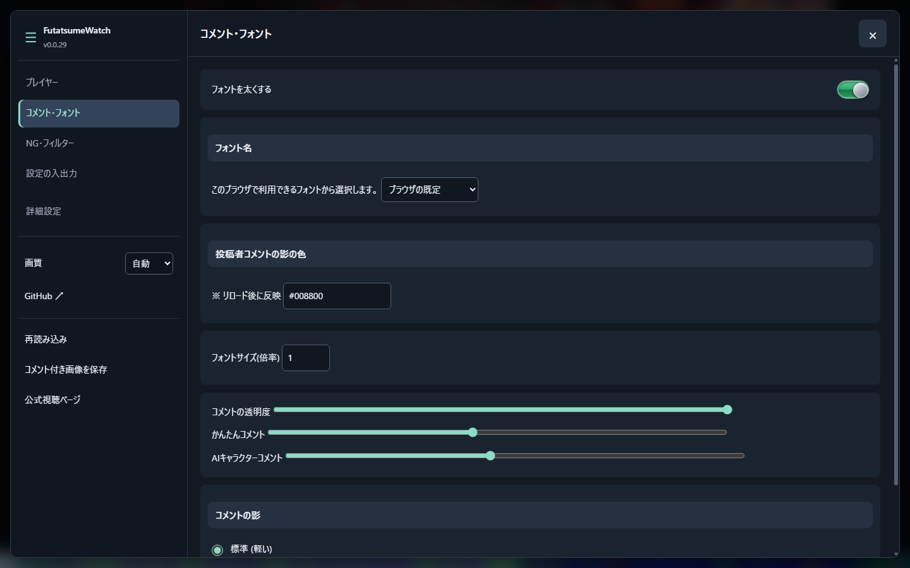

NG・フィルターの設定

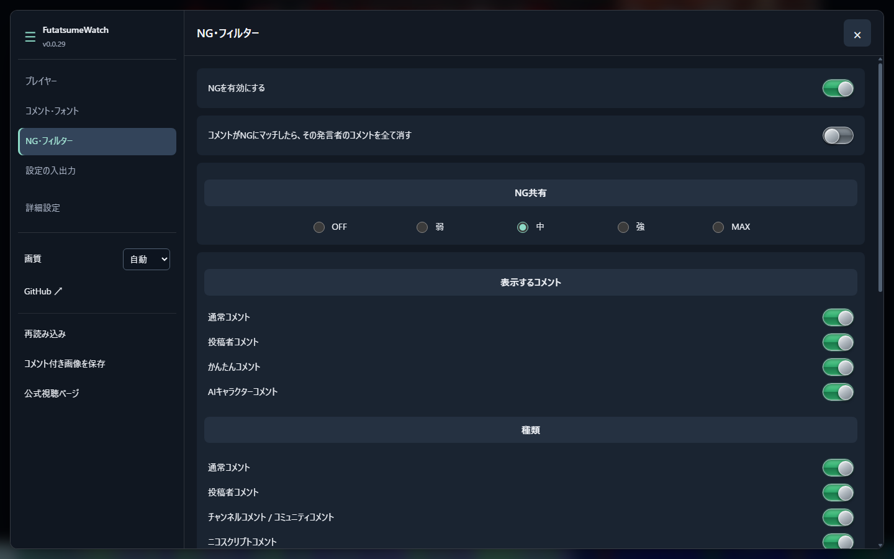

設定の入出力

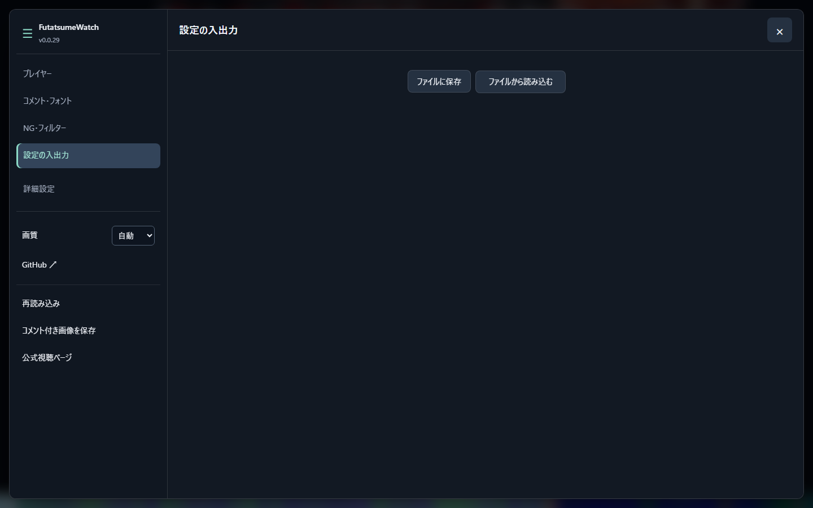

詳細設定

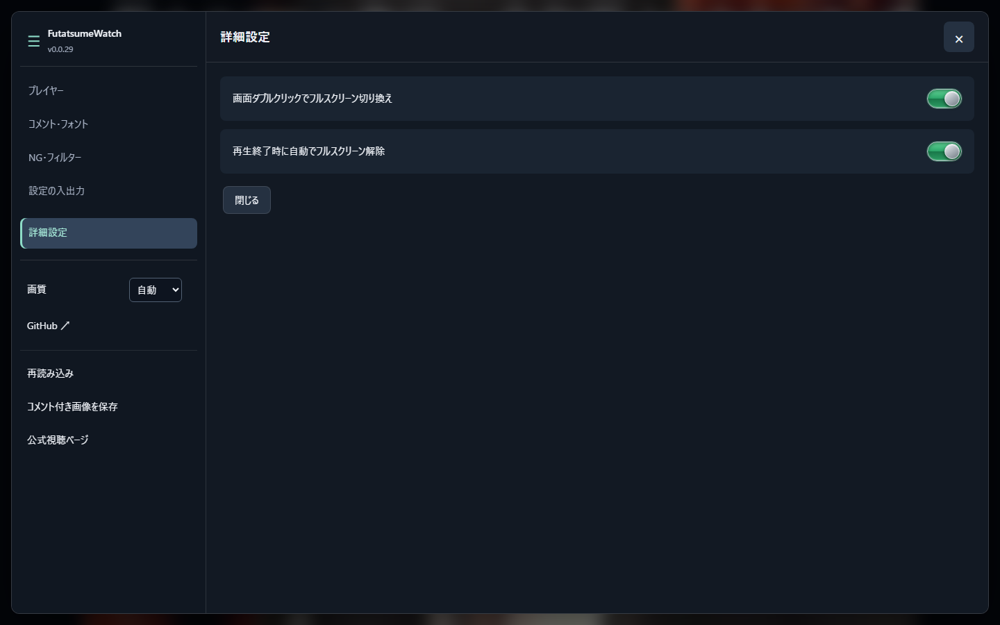

### 右側のタブを切り替える

右上のボタンから右パネルを開き、上端のアイコンで4つのタブを切り替えます。カギのボタンで固定すると、動画とコメントがパネルの左側に収まり、再生を見ながら操作できます。

動画情報：説明文やタグを見る

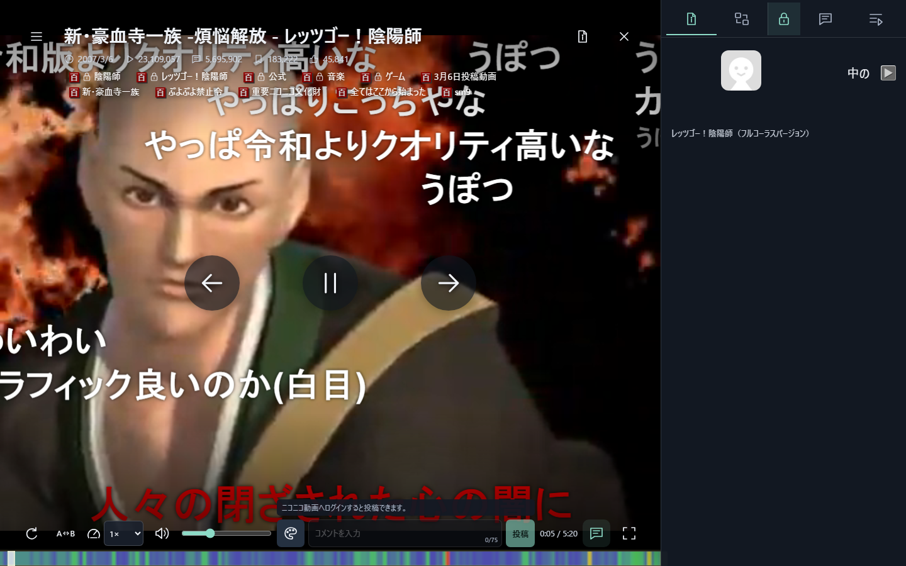

関連動画：次に見る動画を探す

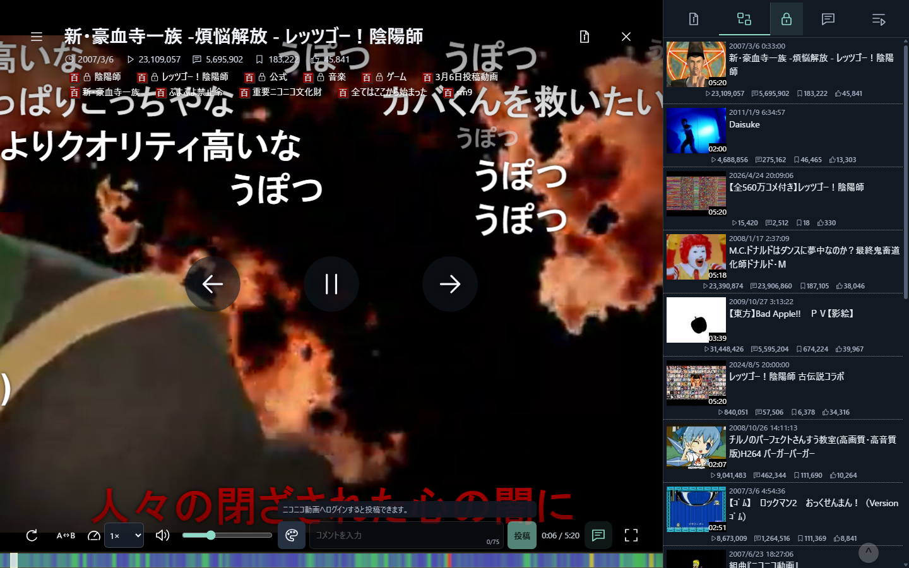

コメント：コメントの一覧を見る

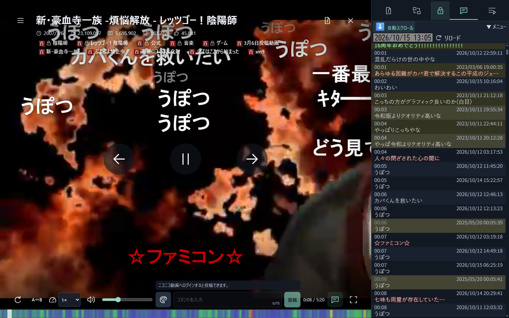

プレイリスト：再生する動画の一覧を見る

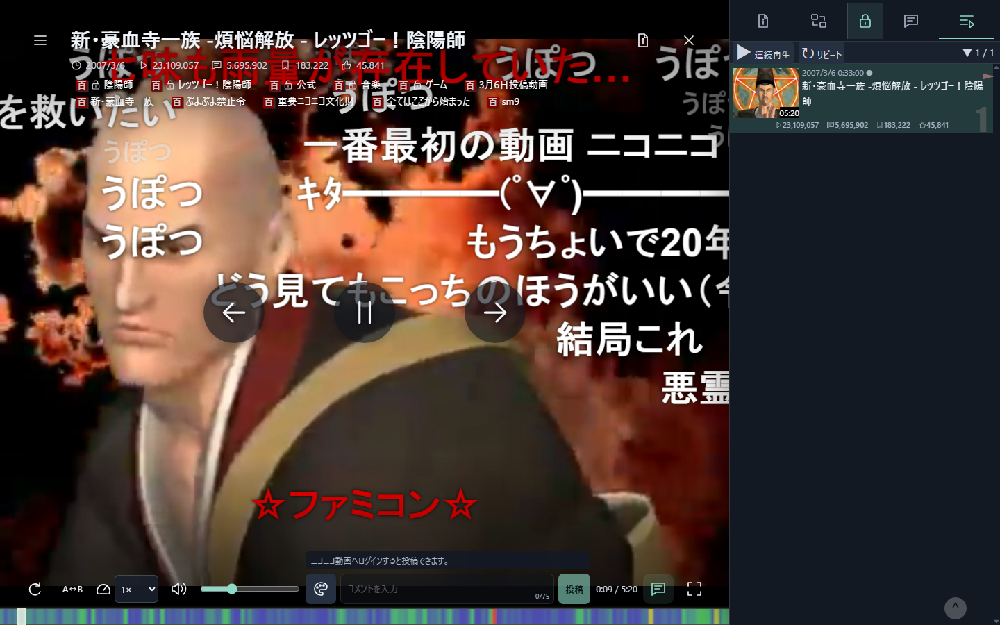

### ユーザースクリプトを更新する

Tampermonkeyのアイコンからダッシュボードを開き、FutatsumeWatchの行にチェックを入れます。上の操作欄で「更新を確認」を選んで「実行」を押し、新しい版があれば案内に従って更新してください。更新後、開いていたページを再読み込みすると新しい版が適用されます。

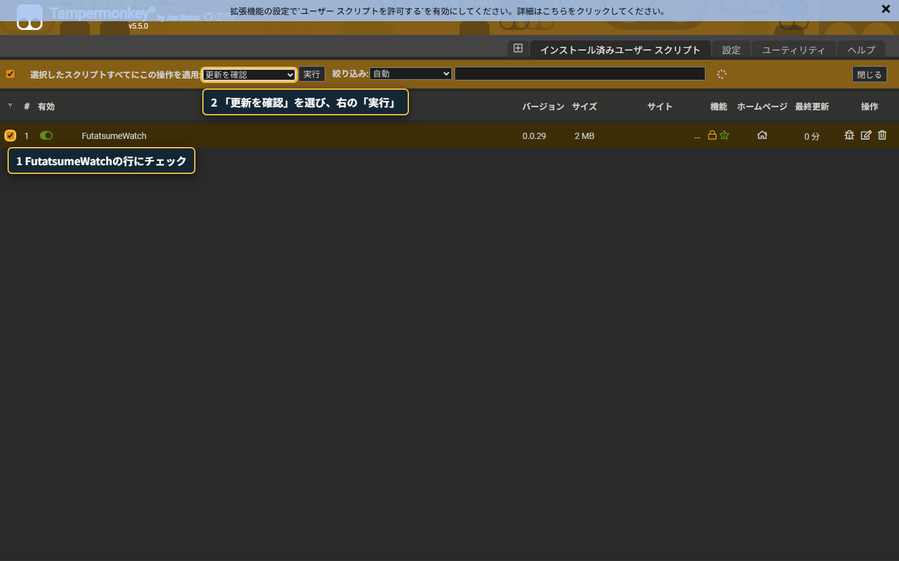

自動更新もTampermonkey側で設定できます。更新前に戻せるようにしておきたい場合は、現在のスクリプトをエクスポートして保管してください。

### その他の操作

再生中、動画タイトル・件数の下にあるタグ一覧をダブルクリックすると編集できます。タグを入力して「追加」、各タグの×で削除します。カギ付きのタグは削除できません。タグ領域外をクリックすると編集を終了します。編集にはニコニコ動画へのログインと、その動画のタグ編集権限が必要です。

動画詳細の「動画情報」タブでは、説明文内の動画リンクにタイトル・サムネイル・再生時間・投稿日・件数を表示します。元のリンクやカードから再生でき、カードのサムネイルへカーソルを合わせるとプレイリストへ追加できます。

新しい視聴ページ形式（watchV4）にも対応し、従来形式と同じ再生・画質選択の操作を使えます。

シークバーへマウスを合わせると、サムネイル内にその時点のコメントを最大3件表示します。コメント一覧への切り替えもできます。

動画リンクのホバーメニューや、再生中の関連動画・プレイリストの動画行にある「とり」でとりあえずマイリストへ追加できます。「マイ」からは専用画面を開き、追加先の選択、マイリストの作成・名前や説明の編集、登録動画のメモ編集と削除ができます。専用画面は背景クリックやEscapeでも閉じられます。操作にはニコニコ動画へのログインが必要です。

## 同梱機能

- メンテナンスしやすい機能のみに限定。意図的に複雑な機能は削除。

## 特徴

- TypeScriptの型検査で、型の不整合を確認。実行時の動作は単体・結合・ブラウザテストで検証。
- 豊富な結合テスト・単体テストで検証済み。
- 主要機能は手動テスト済み。全機能の確認を保証するものではなく、確認範囲は [検証記録](verification.md) を参照。
- 現代的なユーザーインターフェース。モバイル環境でも利用可能。
- comment-overlayエンジンによる高いコメントアート互換性。

## バグ報告・機能提案

[Issue](https://github.com/roflsunriz/FutatsumeWatch/issues)

## コード提案

[PullRequest](https://github.com/roflsunriz/FutatsumeWatch/pulls)

## 開発

詳細は [findings.md](findings.md#readme-1) に移しました。

## ライセンス

[MIT License](LICENSE)

## 依存更新の自動処理

詳細は [findings.md](findings.md#readme-2) に移しました。
